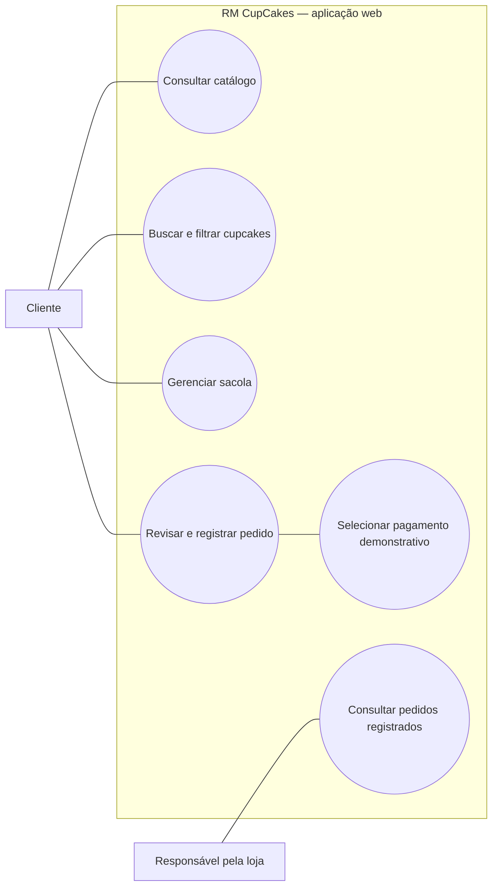
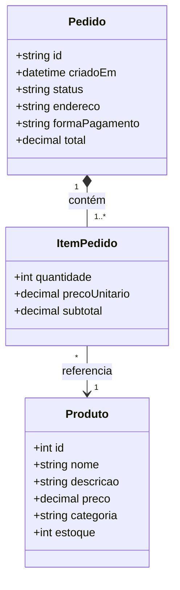
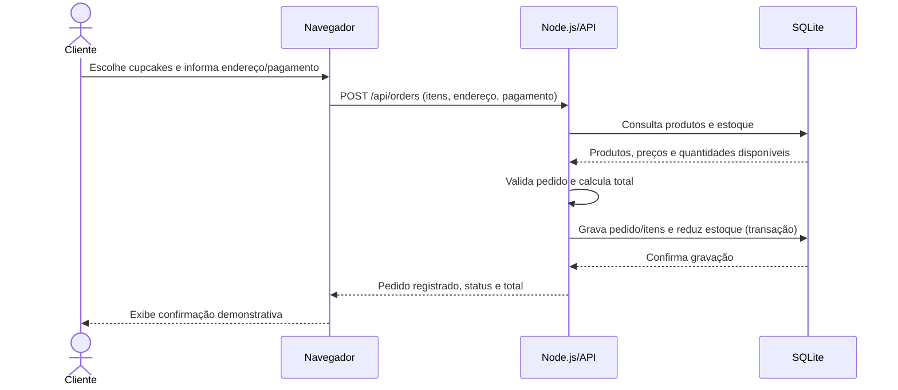

# Diagramas UML — RM CupCakes

Diagramas de análise para a aplicação web demonstrativa. Os fluxos representam somente as funcionalidades presentes no MVP.

## 1. Casos de uso

## 2. Diagrama de classes

## 3. Diagrama de sequência — registrar pedido

Os diagramas foram escritos em Mermaid para facilitar a revisão no GitHub. Eles podem ser exportados para imagem pelo diagrams.net ou por um renderizador Mermaid se o relatório exigir arquivos de imagem.
